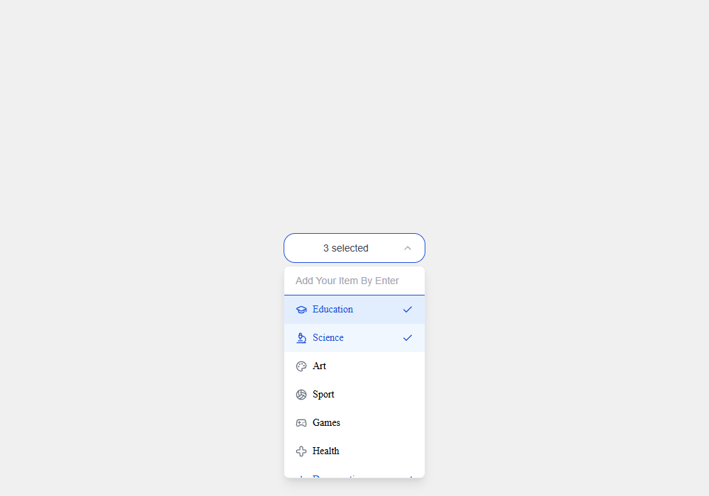

# Lobox multi-select exercise

A small React/TypeScript interview exercise implementing a multi-select dropdown
with a custom state hook. It is a learning exercise, not a released UI library.



Open the dropdown, select Education and Science, then type `Demo option` and
press Enter. The new item appears but is selected only when clicked. Clicking a
selected item deselects it; clicking outside closes the menu. Whitespace-only
items are rejected. Options and selections stay in memory and reset on reload.
The text input adds items; it does not filter the existing list.

The [dropdown component](src/components/simpleDropDown/index.tsx) delegates
selection, item creation and outside-click cleanup to
[useDropDown](src/customHooks/dropDown/useDropDown.tsx).

## Run locally

Verified on Windows with Node.js 24.11.1 and npm 11.6.2. The lockfile uses React
18, TypeScript 4.9 and Create React App/react-scripts 5. No backend or application
credentials are required.

```sh
git clone https://github.com/boyInShadows/lobox.git
cd lobox
npm ci
npm start
```

Open <http://localhost:3000>. Existing checks:

```sh
npx tsc --noEmit
npm run build
npm test -- --watchAll=false --runInBand
```

On 2026-10-30, locked install, typecheck and production build passed. Build has
an existing unused-variable warning and old Browserslist/deprecation notices.
The test command exits 1 because no tests are present; it is not a passing suite.
Edge verified multi-selection, Enter creation, blank rejection, outside-click
dismissal and reset on reload against the production build, with no page errors.

Keyboard support is incomplete: Enter creates an item, while Escape does not
close the menu and option rows lack keyboard/listbox semantics. Mobile usability
and full accessibility are unverified. A dated npm audit reported 68 advisories
(3 critical, 34 high, 13 moderate, 18 low). No dependency migration or quality CI
was added. Existing history and dependency/asset rights remain unchanged.
